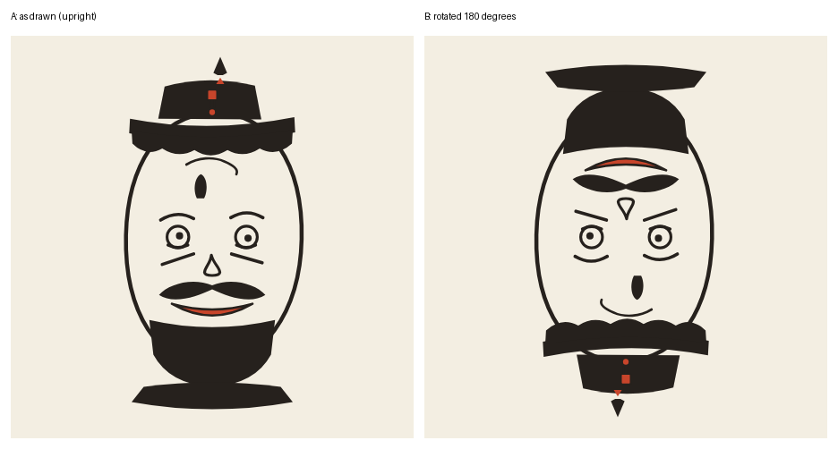
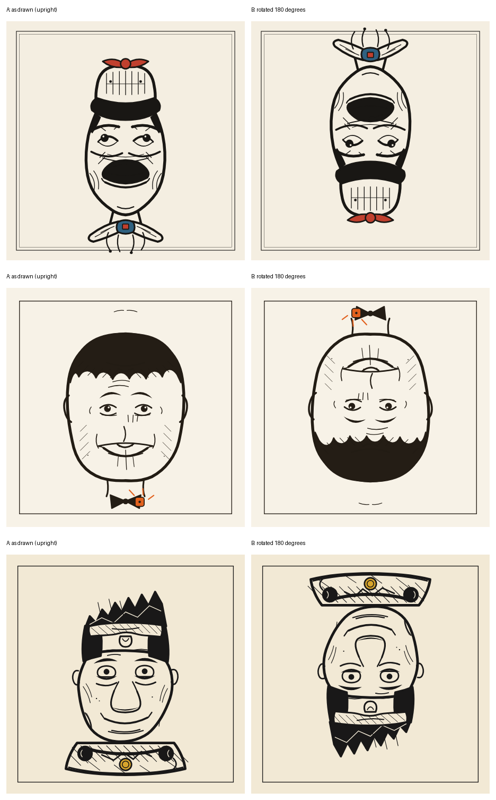

# Reversible Faces Benchmark

**Evaluating geometric consistency, perceptual ambiguity, and semantic composition in generative AI.**

An experimental framework, with reproducible offline tooling and archived artifacts, for testing whether language models can synthesize **a single vector drawing that supports two distinct facial interpretations under a 180° rotation**. Inspired by the reversible caricatures of Rex Whistler, the benchmark combines geometric constraint satisfaction, programmatic drawing, perceptual recognition and visual communication.

<p align="center">
  
</p>
<p align="center"><em>One SVG evaluated in two orientations (MiniMax, prompt v5, round 3). The right-hand image is obtained solely by rotating the left-hand one by 180°. Previews are illustrations; the benchmark is judged on the SVG itself.</em></p>

**Research status:** exploratory benchmark · four evaluated rounds (rounds 1–4, plus an unevaluated pilot) · three primary models · fifteen additional comparison runs · open experimental artifacts and a Python harness.

[Paper](paper/reversible-faces-benchmark-paper.md) · [Methodology](docs/methodology.md) · [Results](#experimental-results) · [Geometry](docs/geometry.md) · [Reproduction](docs/reproduction.md) · [Documentation map](docs/README.md)

> **Not a leaderboard.** The main study has one human evaluator, who is also the benchmark's author, and one evaluated output per model per prompt. There is no validated scoring scale and no statistical inference. Read the results as observations that motivate controlled experiments ([Interpretation and limitations](#interpretation-and-limitations)).

---

## Contents

- [Problem definition](#problem-definition)
- [Why this is a difficult generation task](#why-this-is-a-difficult-generation-task)
- [Experimental design](#experimental-design)
- [Experimental results](#experimental-results)
- [Interpretation and limitations](#interpretation-and-limitations)
- [Geometric formulation](#geometric-formulation)
- [Implementation](#implementation)
- [Reproducibility](#reproducibility)
- [Security](#security)
- [Running the benchmark](#running-the-benchmark)
- [Open research questions](#open-research-questions)
- [Research context](#research-context)
- [Repository layout](#repository-layout)
- [Citation and licensing](#citation-and-licensing)

---

## Problem definition

The task is to generate a single image $I$ satisfying two perceptual constraints:

$$P_A(I) \geq \tau_A \qquad\text{and}\qquad P_B(R(I)) \geq \tau_B$$

where:

- $I$ is a vector drawing;
- $R$ is a rotation by 180°;
- $P_A$ and $P_B$ represent the recognizability of two distinct faces, A and B;
- $\tau_A$ and $\tau_B$ are conceptual recognition thresholds.

Both interpretations must arise from the **same drawing**. Overlaying two independently constructed faces is not sufficient.

The prompts used in the rounds additionally require artistic coherence and a visual joke referring to a recent technology or AI event, communicated through the relationship between the two orientations and without any text.

The central problem is therefore **not rotational symmetry**. It is **dual-interpretation synthesis under a fixed geometric transformation**. The desired output must belong to the intersection of two perceptual feasibility regions:

$$I \in C_A \cap R[C_B]$$

Here $C_A$ and $C_B$ denote the sets of drawings recognizable as the respective faces, and $R[C_B]$ is the image of $C_B$ under the half-turn. These regions are conceptual, not computationally characterized. Recognition is evaluated by a human.

## Why this is a difficult generation task

Rotation is mathematically trivial:

$$R(x, y) = (1000 - x,\; 1000 - y)$$

in the 1000 × 1000 coordinate system of the contract.

Constructing a drawing that keeps meaningful facial structure in both orientations is not. The two interpretations impose coupled constraints on the same geometry. Typical design correspondences (heuristics, not universal rules):

| Feature at 0° | Possible interpretation at 180° |
|---|---|
| Hair or hat | Beard |
| Eyebrows | Under-eye wrinkles |
| Hat brim | Nose |
| Smile | Hatband |
| Collar or bow tie | Hat ornament or pompom |

A stroke optimized for one interpretation can destroy the other, and geometric alignment alone does not guarantee perceptual recognition. The task connects capabilities that are usually evaluated separately:

- **Geometric reasoning.** Keeping coordinates consistent across a global transformation.
- **Constraint satisfaction.** Local changes must preserve the recognizability of both interpretations.
- **Program synthesis.** The output is executable vector graphics (SVG code), not an image description.
- **Perceptual modeling.** Anticipating how a human observer groups lines into facial features.
- **Semantic composition.** Using the relationship between the two faces to communicate an idea.

These requirements compete: more detail, artistic complexity or narrative specificity can interfere with geometric feasibility. Round 2 below is an example in this repository.

## Experimental design

The benchmark uses text-based language models that write SVG. SVG makes the geometry explicit and lets outputs be inspected, transformed, validated, rendered and archived without an opaque raster generation process.

### Output contract

The prompts ask each model to produce:

- one standalone SVG document;
- a `viewBox="0 0 1000 1000"` coordinate system, with `width="1000" height="1000"` (the runners add `xmlns`, `viewBox` and the size if a model leaves them out);
- two distinct facial interpretations under a 180° rotation;
- no visible text or captions;
- no external references or executable content, and no gradients or filters;
- a maximum file size of 300 KB.

Validity of the file ([`scripts/validate_svg.py`](scripts/validate_svg.py)) and perceptual success (a human judgment) are evaluated separately. The validator never judges the drawing. The current validator enforces this contract exactly; the validator used when the rounds were run was weaker, which did not affect the results ([Threats to validity](docs/threats-to-validity.md#validator-historical-limits-current-capabilities-and-impact)).

### Evaluation protocols

The repository records two generation protocols. Do not pool or rank across them.

| Protocol | Description | Rounds |
|---|---|---|
| **One-shot, no tools** | One prompt, one model response, no rendering or iterative feedback | 0–3 |
| **Single-attempt, tool-augmented** | One initial prompt, then an autonomous loop of sandboxed code execution and rendering of the model's own SVG (upright and rotated), within fixed limits | 4 |

In the first protocol the model must reason about the drawing without seeing it. In the second it may generate code, inspect its render in both orientations and revise within the limits (5 renders, 12 tool calls, 16 turns, and an approximate cost cap of US$0.25 per model). No person gives feedback in either protocol; the harness returns the tool results.

Round 4 is **not a controlled comparison of tool access alone**: prompt v6 and other conditions also changed, and the harness additionally showed the model an advisory symmetry number (ρ) and an element table, which the earlier rounds had no equivalent of. See [Methodology](docs/methodology.md) and the [round 4 setup](rounds/round-04/SETUP.md).

### Judging

The judge in the rounds is a human who opens the SVG, looks at it and turns it upside down. The evaluation is **not blind** to the generating model. There is no rubric: earlier rubric-based drafts are kept, marked as superseded, in [`docs/design-history/`](docs/design-history/). The only checklist is the self-check inside the prompt, which the *model* uses before delivering.

## Experimental results

The primary study evaluated three models, accessed through [OpenRouter](https://openrouter.ai):

- `deepseek/deepseek-v4.1-flash`
- `z-ai/glm-5.3-flash`
- `minimax/minimax-m3.1-flash`

Settings that matter when reading the results:

| Model | Notes |
|---|---|
| `deepseek/deepseek-v4.1-flash` | With reasoning on it kept re-verifying its geometry until the token limit and delivered nothing in round 3; the round 3 and round 4 results were produced with reasoning disabled. |
| `z-ai/glm-5.3-flash` | Default reasoning effort (medium); had the lowest delivered-run cost in every evaluated round. |
| `minimax/minimax-m3.1-flash` | Heavy reasoning; low effort used in round 2 (second attempt), round 3 and round 4. The round 4 result is a re-run at 64000 tokens per turn. |

The sequence investigates how prompt structure and tool availability affected the drawings. Verdicts below are the evaluator's qualitative words (see each round's `EVALUATION.md`), not success rates. The images in the strips show, from top to bottom: DeepSeek, GLM, MiniMax.

| Round | Prompt | Protocol | Verdict |
|---|---|---|---|
| 0 (pilot) | v1 | one-shot | Not human-evaluated; used to improve the prompt |
| 1 | v2 (MiniMax), v3 (DeepSeek, GLM) | one-shot | Effect OK for DeepSeek and MiniMax, somewhat bad for GLM; low artistic quality; two somewhat funny; no impactful use of the event |
| 2 | v4 | one-shot | All three lost the 180° reading |
| 3 | v5 | one-shot | Identifiable faces in both orientations for all three; artistic quality improved |
| 4 | v6 | tool-augmented | Reversible and well made for all three; none conveys a comic message |

### Round 1: initial feasibility

Two of the three outputs were judged to show an acceptable reversible effect; artistic quality was limited. (The MiniMax output is from prompt v2, because its v3 run was interrupted.) In this setting the result suggests that explicit geometric instructions and feature correspondences can help a model build two readings; note that the prompt version differed between models in this round.

<p align="center"></p>

### Round 2: increased instruction complexity

Prompt v4 made the event central and added heavy art direction. All three outputs lost the recognizable second face under rotation.

<p align="center"></p>

This suggests that extra aesthetic and semantic requirements can interfere with satisfying the primary geometric constraint. Because several prompt components changed at once, the experiment does not show which component caused the deterioration.

### Round 3: geometric prioritization

Prompt v5 was rebuilt around an explicit order of operations: establish reversible geometry; verify the correspondence under rotation by writing the rotated coordinates; add artistic detail only without compromising either reading. All three models produced drawings judged to contain identifiable faces in both orientations. DeepSeek ran with reasoning disabled in this round (with reasoning on it did not deliver an SVG), so its result is not comparable with the other two; MiniMax ran at low reasoning effort.

<p align="center"></p>

Decomposition and constraint prioritization look like promising strategies. Controlled ablations are needed to isolate their effects.

### Round 4: tool-augmented generation

Models received sandboxed Python execution and an SVG renderer that returned both orientations for inspection. All three produced drawings judged reversible and well made; **none was judged to convey a comic message**. MiniMax was re-run once (its first run spent its first turn reasoning and never used a tool) and the re-run is the reported result.

<p align="center"></p>

This points to an unresolved distinction between satisfying the geometric and perceptual constraints and building a meaningful relationship between the two interpretations. Round 4 was produced by the harness as it was before hardening ([Security](#security)).

### Additional baselines

After round 4, fifteen further comparison runs evaluated raster image generators and additional language models. Under the tested conditions:

- four raster image generators (plain prompt, no benchmark scaffolding) were all judged by the author to have failed (for example two stacked faces or a head with a tiny second head in the collar), i.e. none was one drawing read two ways;
- seven of eleven text-model outputs (benchmark prompt v5) were judged successful on the core reversible-face requirement.

These are descriptive observations, **not controlled model rankings**: the raster generators and the text models received different prompts, one text-model run (GLM 5.3 Max) used iterative rendering, and some protocol details were not recorded. A second AI agent (text-only, working from descriptions written by an auxiliary vision model that sometimes invented the expected second face) judged every image in both orientations without being told the model or the author's verdict; its agreement with the author was 11/15 (single orientation) and 9/15 (side-by-side), and the assistant's own rubric scores, which agree 15/15, were not blind and are **not an independent check**. The comparison documents these limits. See [`baselines/`](baselines/README.md) and the [judge comparison](baselines/JUDGE-COMPARISON.md).

### Costs

All model calls in rounds 0–4 cost roughly sixty cents in total (provider-reported; failed and billed-but-unreported requests make this a lower bound). Per-run tokens and costs are in each round's `logs/` and `EVALUATION.md`.

## Interpretation and limitations

The experiments are exploratory.

- The main study used **one human evaluator, who is also the benchmark author** (not blind to the generating model), and one evaluated output per model per prompt, apart from retries after technical failures; the one re-run that was selected is declared (MiniMax, round 4).
- Whether the evaluator read each model's declared `EVENT:`/`TITLE:` lines before judging was not recorded.
- Model settings differed between rounds (for example DeepSeek ran with reasoning disabled in rounds 3 and 4), and providers were not pinned.
- There is **no validated scoring scale**, inter-rater reliability estimate or statistical inference.
- Success on this task mixes capability, reliability and efficiency. A single output can show that a model *can* produce a reversible figure; it says nothing about how often, or at what token and cost budget. A run that exhausts its token budget while verifying (as DeepSeek did with reasoning on in round 3) is a task-completion failure under that inference regime, not evidence of geometric incapacity.
- Automated judge experiments revealed further problems, such as vision descriptions that invented the expected second face.
- Prompts v1–v5 contain short text descriptions of two Whistler drawings that were drafted from public images and never verified (prompt v6 removed them), plus a literal production note. They are kept verbatim because the models saw them. The events named in the rounds are whatever each model declared and were not fact-checked.

The results should be read as observations motivating further experiments, not as general claims about model capabilities. Full list: [Threats to validity](docs/threats-to-validity.md).

## Geometric formulation

The half-turn $R$ is an involution,

$$R^2 = \mathrm{id},$$

and generates the cyclic group $C_2$. For a raster representation of the image, the parts that are even and odd under the half-turn are

$$I_+ = \frac{I + R(I)}{2}, \qquad I_- = \frac{I - R(I)}{2},$$

so that

$$I = I_+ + I_-, \qquad R(I) = I_+ - I_-.$$

This decomposition describes how the transformation acts on the image. It does not by itself separate the two semantic interpretations.

### Shared-stroke construction

Consider a stroke with target position $a$ in face A and target position $b$ in face B's own coordinate frame (on the page, B's target is $R(b)$). A shared stroke $s$ can be chosen by minimizing

$$L(s) = w_A \lVert s - a \rVert^2 + w_B \lVert s - R(b) \rVert^2$$

whose minimizer is the weighted compromise

$$s^{*} = \frac{w_A\, a + w_B\, R(b)}{w_A + w_B}.$$

For equal weights, $s^{*} = \dfrac{a + R(b)}{2}$. This is a construction heuristic for strokes that must satisfy two configurations. It does **not** guarantee semantic validity: a geometrically optimal compromise can be perceptually meaningless. The geometry of the transformation is exact; the geometry of recognition is perceptual. The repository uses these equations as a planning framework, not as a complete generative algorithm.

Derivations, silhouette constraints, recognition regions and the symmetry diagnostic are in [Geometry](docs/geometry.md). A plain-language version is in [How it works](docs/how-it-works.md).

## Implementation

The repository contains the experimental data and the infrastructure to produce and inspect it. The scripts are the current (hardened, version 2.1.0) versions; round 4 itself was produced by an earlier harness (commit `07d7ff8`) with the same prompts, tools and limits, but without the sandboxed renderer, the sanitizer and the pre-call cost estimate. The earlier code is available with `git show 07d7ff8:scripts/run_models_v6.py`.

| Component | Purpose |
|---|---|
| [`scripts/run_models.py`](scripts/run_models.py) | One-shot model execution (rounds 0–3 protocol) |
| [`scripts/run_models_v6.py`](scripts/run_models_v6.py) | Tool-augmented generation loop (round 4 protocol) |
| [`scripts/validate_svg.py`](scripts/validate_svg.py) | SVG file-contract and safety validation |
| [`scripts/svg_safety.py`](scripts/svg_safety.py) | Safe parsing and allowlist sanitization |
| [`scripts/safe_render.py`](scripts/safe_render.py) | Isolated browser rendering (Chrome inside bubblewrap) |
| [`scripts/render_preview.py`](scripts/render_preview.py) | Upright and rotated previews |
| [`scripts/perceptual.py`](scripts/perceptual.py) | Advisory image diagnostics (not validity) |
| [`scripts/rfb_common.py`](scripts/rfb_common.py) | Cost estimate, structured API log, no-overwrite output directories |
| [`scripts/mock_openrouter.py`](scripts/mock_openrouter.py) | Offline harness testing with a scripted fake API |
| [`tests/`](tests/README.md) | Validation, security, harness and baseline tests |

## Reproducibility

Original prompts, SVGs, raw responses, reasoning traces where the provider returned them, execution logs and provider-reported costs are retained for every round. For round 4 the transcripts contain every model message, tool call and tool result; the intermediate render images are not stored.

Model runs are **not** reproducible bit for bit: there are no seeds, providers and sampling configurations can change, model ids can be retired, and rendering can differ slightly across browsers. The offline parts (tests, validator, previews) are reproducible. Tested versions and limits: [Reproduction](docs/reproduction.md).

The cost budget in the tool-augmented harness is an **operational limit, not a financial guarantee**: the round-4 harness stopped once the provider-reported cost reached the cap, and the current harness also estimates the worst case before each call; in both, a failed request that is billed and not reported can exceed the cap, so reported totals are lower bounds.

## Security

Model-generated SVG and Python code are **untrusted input**. The current implementation uses XML-safe parsing (`defusedxml`), allowlist sanitization, browser isolation through bubblewrap, restricted filesystem access and bounded execution. Rendering refuses to run without bubblewrap.

The current hardened implementation **differs from the harness that produced round 4**: that harness (commit `07d7ff8`) ran Chrome with `--no-sandbox` outside the sandbox and cleaned SVG with regular expressions. The delivered round-4 SVGs contain only plain drawing elements, so there is no sign that the results were affected, but equivalence with the current rendering path was assumed, not re-run; the exposure existed and is closed in the current code. The round-4 runs were not repeated. Details and residual risks: [Security](docs/security.md) and [Validator audit](docs/validator-audit.md).

## Running the benchmark

Requirements:

- Python 3.9 or newer
- the packages in [`requirements.txt`](requirements.txt)
- an OpenRouter API key for model execution (not needed for the offline tests or `--mock`)
- Chrome or Chromium and `bubblewrap` on Linux for safe SVG rendering (previews and round-4-style runs)

```bash
git clone https://github.com/ClaudioDrews/reversible-faces-benchmark.git
cd reversible-faces-benchmark
pip install -r requirements.txt
```

Run a one-shot experiment (the key is read from the environment, never from a file):

```bash
export OPENROUTER_API_KEY="your-api-key"
python scripts/run_models.py runs/experiment-01 prompts/prompt-v5.md z-ai/glm-5.3-flash
```

Environment variables: `EFFORT` (default `medium`), `NOREASON=1`, `MAXTOK` (default 64000 for `run_models.py`, 32000 for `run_models_v6.py`), `STRIP_METADATA=1`, `COST_CAP_USD`. Per-round settings are in each `EVALUATION.md`; for example DeepSeek in round 3 used `NOREASON=1 MAXTOK=20000`, MiniMax `EFFORT=low`, and GLM the defaults. Both runners refuse to write into a non-empty output directory unless `--timestamped` or `--force` is given.

Validate the output:

```bash
python scripts/validate_svg.py runs/experiment-01/*.svg
```

Run the offline test suite (no key, no network, no cost):

```bash
python -m unittest discover -s tests
```

Test either runner without API calls (scripted fake API):

```bash
python scripts/run_models.py --mock /tmp/rfb-smoke-oneshot prompts/prompt-v5.md z-ai/glm-5.3-flash
python scripts/run_models_v6.py --mock /tmp/rfb-smoke prompts/prompt-v6.md z-ai/glm-5.3-flash
```

Optional side-by-side preview of one SVG (upright and rotated):

```bash
python scripts/render_preview.py runs/experiment-01/glm-5.3-flash.svg preview.png
```

The judgment itself is human: look at the drawing, rotate it and decide. Validate first, then look at the sandboxed preview from `render_preview.py`; do not open unvalidated model-written SVG in a personal browser (the previews and the harness never render it raw). For model-specific settings, costs, execution limits and rendering requirements, see [Reproduction](docs/reproduction.md).

## Open research questions

The current experiments motivate several questions (details and proposed protocols in [Future work](docs/future-work.md)):

1. **Constraint interference.** How does added aesthetic or semantic complexity change the probability of satisfying a primary geometric constraint?
2. **Planning and decomposition.** Does explicit geometric prioritization help independently of prompt length and the other instructions?
3. **Visual feedback.** What is the effect of rendering and inspection on success rates, iteration counts and cost, with everything else held constant?
4. **Perceptual evaluation.** Can independent observers, and multimodal evaluators, identify integrated reversible figures without inventing the expected features? Is the intended visual message understood without explanation?
5. **Semantic composition.** Can a model produce two individually recognizable interpretations whose relationship communicates an intended idea, satire or joke? In round 4 one evaluator found no comic message in any of three outputs, which suggests that humor rather than geometry may now be the bottleneck; that is a hypothesis, not a finding.
6. **Generalization.** Do the same strategies extend to rotational ambigrams, multi-view images and other transformation-dependent visual meaning?

These questions need repeated trials, controlled prompt variants and independent evaluation.

## Research context

The benchmark draws on three lines of work:

- **Reversible images and perceptual ambiguity**, including the drawings of Rex Whistler (*OHO! Certain Two-Faced Individuals*, 1946) and research on face inversion.
- **Ambigram and multi-view image generation**, where one visual representation supports different interpretations under a transformation.
- **Language-model drawing and program synthesis**, where structured graphics expose the model's geometric construction process.

The objective is not to reproduce Whistler's artistic technique but to investigate how generative models satisfy coupled geometric and perceptual constraints. See [Related work](docs/related-work.md) and the verified [bibliography](docs/references.md). The original Whistler drawings are not included in this repository.

## Repository layout

```
README.md                 this file
PUBLISH-CHECKLIST.md      pre-publication tasks and their status
CITATION.cff              citation metadata (CFF 1.2.0)
LICENSE, LICENSE-CONTENT, LICENSING.md
paper/                    the accompanying paper (v2.0, rounds 0-3) and its scope note
docs/                     navigation map in docs/README.md; geometry, methodology, security, reviews, ...
prompts/                  prompt-v1.md ... prompt-v6.md, exactly as sent; discarded/ variants
rounds/                   one folder per round (svg/, raw/, logs/, EVALUATION.md); index in rounds/README.md
baselines/                15 comparison runs, judge comparison and blind evaluations
scripts/                  runners, validator, sanitizer, sandboxed renderer, diagnostics
tests/                    offline tests and fixtures
assets/previews/          PNG previews used in the documentation
to-do.md                  planned next versions of the benchmark
```

## Citation and licensing

Claudio Drews (2026). *Reversible Faces Benchmark: a one-shot test of rotation-consistent line drawing in language models* (paper version 2.0, rounds 0–3). To cite the repository itself (version 2.1.0: prompts v1–v6, round 4, the hardened scripts and tests) use the top-level fields of [`CITATION.cff`](CITATION.cff); the paper has its own entry there (`preferred-citation`). The repository version and the paper version are different things.

Copyright (c) 2026 Claudio Drews.

- **Code** (`scripts/`, `tests/`): MIT, see [`LICENSE`](LICENSE).
- **Research content and artifacts** (paper, docs, prompts, evaluations, logs, SVGs, raw outputs, previews): CC BY 4.0, see [`LICENSE-CONTENT`](LICENSE-CONTENT), subject to the qualifications in [`LICENSING.md`](LICENSING.md) (for example for AI-generated outputs).

Note on names: the prompts v1–v5 (and quotations of them in the docs) keep, verbatim, the production note "[PLACEHOLDER — Cláudio to add and verify.]" because the models received it; elsewhere the author's name is written "Claudio Drews".
