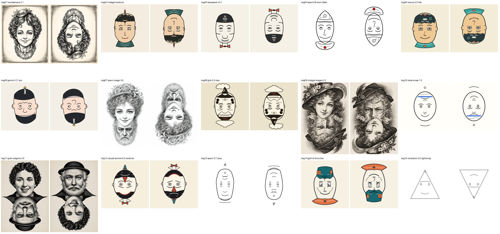

# Baselines: image generators and text models, compared

This section holds **15 comparison runs** that were *not* part of rounds 0-4 of the benchmark. They answer two questions Claudio Drews asked after the rounds:

1. What do ordinary **raster image generators** do with the task when they are given a **plain prompt** (the "shared-eyes" prompt, no benchmark scaffolding)?
2. What do a wider set of **text models** do with **benchmark prompt v5** (one shot, SVG), beyond the three cheap models of rounds 0-3?

For all 15 images this section records Claudio's verdict, the verdicts of David (Peter's Hermes agent), who judged each image **blind, in both orientations**, and the impressions and rubric scores of Peter Weyland (Claudio's Grok Bot assistant), who prepared this repository (called "Peter" below). Everything is in English; quotes in the original Portuguese were translated.

*Figure: every image upright (left of each pair) and rotated by 180° (right). The `imgNN` labels are the blind ids used in the comparison.*

## Read this first: caveats that apply to everything below

> These are the caveats Claudio flagged as important. They are repeated in [`JUDGE-COMPARISON.md`](JUDGE-COMPARISON.md) and must travel with any number taken from this section.

1. **David is text-only.** His model cannot see pixels. Hermes first sends each image to an **auxiliary vision model that writes a description**, which is injected into David's prompt; David can also call `vision_analyze` with his own question. David's "perception" is therefore reasoning over a vision model's text, not direct viewing.
2. **The describer sometimes hallucinates the expected second face.** Example: for the Nano Banana image, the description of the side-by-side panel *invents an old man* in the rotated panel, although the large face in the rotated reading is still the same lady, upside down (the old man is only a tiny head in the collar). David then scored it as a pass. Excerpts are in [`david-evals/vision-describer-excerpts.md`](david-evals/vision-describer-excerpts.md).
3. **Orientation mix-ups.** On the Qwen Image output David said the old man is "upside-down relative to the lady" at 0°; in the image both faces are upright at 0° and both inverted at 180°. His notion of which way up a face is can be wrong, which is exactly what this benchmark depends on.
4. **Stage 2 is not fully blind to the rotation.** In stage 2 the image shows the drawing twice and *tells* David the right panel is the same drawing rotated 180°. Only stage 1 (one orientation per independent session) is blind in that sense.
5. **One call per cell.** Each image/orientation/stage was asked once: no repeats, no variance estimate, one model with one persona, one prompt wording per stage.
6. **The 0-2 rubric is Peter's own operationalisation** of the three self-check gates in prompt v5 section 7. The repository has no official scored rubric (see [`../docs/methodology.md`](../docs/methodology.md)). It was **scored non-blind**: the assistant knew Claudio's verdicts. Its 15/15 agreement with Claudio is therefore **not an independent result**.
7. **GLM 5.3 Max iterated about nine renders**, with vision feedback on both orientations. It was **not one-shot** and is not directly comparable with the other text models.
8. **Manus 2.0 Lite replied in Portuguese.** Its EVENT/TITLE header (and the code comments, removed on saving) were in Portuguese; the header shown here is a translation.
9. **Meta Muse 1.3** was previously kept local-only; its result is now included, with Claudio's agreement.
10. **Same evaluator as the author, N = 1 per model.** Claudio is also the author of the benchmark. The image generators received a different (plain) prompt from the text models; the two groups are not a controlled comparison.
11. **GPT 5.6 Terra (low) and Nemotron 3.5 Lightning** were pasted into the chat by Claudio as SVG only; their EVENT/TITLE headers were not recorded, and whether they ran strictly one-shot without tools was not recorded.
12. **Raster images are re-encoded copies** (JPEG, downscaled to at most 1536 px where larger; embedded metadata removed) to keep the repository small. The original files are held by Claudio.

## Results table

"Peter rubric" = core score 0-8 and the verdict from the 0-2 gates (see [`JUDGE-COMPARISON.md`](JUDGE-COMPARISON.md)). "David stage 1" = independent single-orientation sessions (both orientations must show one clear face and no clearly visible second face). "David stage 2" = his own PASS/FAIL on the side-by-side panel. A "PASS" from David means he judged it a working reversible face, which is *not* the same as Claudio's verdict.

| Id | Model | Prompt type | Event / title (as declared by the model) | Claudio | Peter rubric (core /8) | David stage 1 | David stage 2 | Peter's impression |
|---|---|---|---|---|---|---|---|---|
| img01 | Nano Banana 2.1 ([folder](nanobanana-2.1-shared-eyes/)) | plain shared-eyes prompt (raster image model) | n/a (plain prompt asks for no event) | FAIL: one head with a tiny head hidden in the collar | FAIL (4) | FAIL | PASS | One clear lady; the second face is a tiny head in the collar, so there is no real second reading. |
| img02 | ChatGPT (medium) ([folder](chatgpt-medium-benchmark/)) | benchmark prompt v5 (text model, SVG) | GPT-5 launch (August 2025) / *Launch Day, Power Drain* | PASS: completed the task | PASS (8) | PASS | PASS | Smiling man becomes a stern bearded man; hair = beard, collar = hat. Same rocket prop on both faces. |
| img03 | DeepSeek v4.1 ([folder](deepseek-v4.1-benchmark/)) | benchmark prompt v5 (text model, SVG) | The 2023 generative-AI boom and the hype/disillusion cycle / *The Bow Tie That Was a Propeller* | FAIL: rotated face cannot be identified | FAIL (5) | PASS | PASS | A reads; in B the nose and mouth of A end up above the eyes, so B is half a face. |
| img04 | Qwen3.8-Omni-Flash ([folder](qwen3.8-omni-flash-benchmark/)) | benchmark prompt v5 (text model, SVG) | generative AI chatbot boom (2023) / *Launch Grin, Aftermath Beard* | FAIL: no face visible when rotated | FAIL (5) | FAIL | FAIL | A reads; B has eyes and a nose but floating hat pieces and a flat mouth line, weak and not clearly different. |
| img05 | Manus 2.0 Lite ([folder](manus-2.0-lite-benchmark/)) | benchmark prompt v5 (text model, SVG) | GPT-4o launch (May 2024) (header translated from Portuguese) / *The Voice and the Echo* | FAIL: second face not clear when rotated | FAIL (6) | PASS | PASS | B reads as a bearded man, but a stray nose stroke sits on its forehead and ghost marks of B show in A's hair. |
| img06 | Gemini 3.1 Pro ([folder](gemini-3.1-pro-benchmark/)) | benchmark prompt v5 (text model, SVG) | SpaceX Starship test flights (2024) / *Launch and RUD* | PASS: "managed some humor" | PASS (8) | PASS | PASS | Strong shared strokes (hair = beard); smirk becomes a frown; clean and readable. |
| img07 | Qwen Image 3.0 ([folder](qwen-image-3.0-shared-eyes/)) | plain shared-eyes prompt (raster image model) | n/a (plain prompt asks for no event) | FAIL: "two stacked faces" | FAIL (3) | FAIL | FAIL | Two upright faces stacked (lady above, old man below); rotated, both are inverted. The "same orientation" failure. |
| img08 | GLM 5.3 Max ([folder](glm-5.3-max-benchmark/)) | benchmark prompt v5 (text model, SVG) | DeepSeek shock, Nvidia ~$600B one-day plunge, Jan 2025 / *To the Moon and Back* | PASS (with caveat): completed the task, image strange | PASS (6) | FAIL | PASS | Both orientations read, but cluttered and strange (cheek discs, clouds); iterated about nine renders. |
| img09 | ChatGPT Images 2.5 ([folder](chatgpt-images-2.5-shared-eyes/)) | plain shared-eyes prompt (raster image model) | n/a (plain prompt asks for no event) | FAIL: two half-heads stacked | FAIL (6) | FAIL | PASS | Two full heads joined at the collar, each clear when upright but never one drawing that turns into another. |
| img10 | Meta Muse 1.3 ([folder](meta-muse-1.3-benchmark/)) | benchmark prompt v5 (text model, SVG) | Apple Vision Pro launch Feb 2024: promise vs fatigue / *The Headset Promise and The Weight* | PASS: simple, reasonably executed | PASS (6) | PASS | PASS | Minimal but both faces read; floating marks are partly orphaned. |
| img11 | Grok Imagine 2.0 ([folder](grok-imagine-2.0-shared-eyes/)) | plain shared-eyes prompt (raster image model) | n/a (plain prompt asks for no event) | FAIL: "two separate faces in opposite orientations" | FAIL (6) | FAIL | PASS | Two separate faces joined at the collars; rotating only swaps which one is upright. |
| img12 | Claude Sonnet 5.5 (medium) ([folder](claude-sonnet-5.5-medium-benchmark/)) | benchmark prompt v5 (text model, SVG) | AI investment boom and bubble worries, 2025 / *Liftoff and Landing* | PASS: both readings work, "even funny" | PASS (8) | FAIL | PASS | Clever sharing (hair = beard, red grin = hat band); cheerful vs sad, with a funny swap of rocket and bow tie. A faint ghost of B is visible upright. |
| img13 | Qwen 3.7 Plus ([folder](qwen-3.7-plus-benchmark/)) | benchmark prompt v5 (text model, SVG) | The Great AI Hype Cycle vs. Backend Crash / *The Pitch and The Crash* | FAIL: strange, did not pass | FAIL (3) | FAIL | PASS | Nearly the same face in both readings and the file contains letter-shaped paths (M, W), against the contract. |
| img14 | GPT 5.6 Terra (low) ([folder](gpt-5.6-terra-low-benchmark/)) | benchmark prompt v5 (text model, SVG) | not recorded | PASS: delivered both faces | PASS (8) | PASS | PASS | Clear contrast (smile under a cap vs scowl with a beard) and different props per face; well integrated. |
| img15 | Nemotron 3.5 Lightning ([folder](nemotron-3.5-lightning-benchmark/)) | benchmark prompt v5 (text model, SVG) | not recorded | PASS: but simplified to the extreme | PASS (6) | PASS | PASS | A triangle with two eyes, a brow and a mouth arc; both readings are only just faces; barely any contrast or prop. |

Counts: Claudio passed 7 of the 11 text-model SVGs (Claude, Gemini, ChatGPT, Muse, GLM with its caveat, GPT 5.6 Terra, Nemotron) and failed all 4 image-generator outputs. The next section summarises how well each judge reproduces those verdicts.

## Agreement with Claudio (15 images: 7 PASS, 8 FAIL)

| Judge | Agrees | Note |
|---|---|---|
| Peter rubric (0-2 gates) | 15/15 | **Not independent**: scored knowing Claudio's verdicts |
| David stage 2 (own verdict, side-by-side) | 9/15 (60%) | passes all 7 of Claudio's PASSes but also 6 of his 8 FAILs; lenient |
| David stage 1 (single orientation, independent) | 11/15 (73%) | better predictor; 2 false FAIL (GLM, Claude: he saw faint "extra faces"), 2 false PASS (DeepSeek, Manus) |

What David notices per orientation, with his verbatim words for every image, is in [`JUDGE-COMPARISON.md`](JUDGE-COMPARISON.md) (per-image section) and [`david-evals/RAW-ANSWERS.md`](david-evals/RAW-ANSWERS.md).

## The two prompts

- **Image generators** received the *shared-eyes* prompt: an ordinary prose prompt asking for a black-and-white Rex Whistler-style pen-and-ink illustration of two different faces sharing one pair of eyes (two placeholder labels for the faces were translated from Portuguese). Its text is in each `*-shared-eyes/prompt.md`. All four failed in Claudio's judgement, and all four show the same pattern: two faces *placed* in the picture (stacked, separate, or one tiny) rather than one set of strokes that is read two ways. Summary: [`EVALUATION-image-generators.md`](EVALUATION-image-generators.md).
- **Text models** received [benchmark prompt v5](../prompts/) one shot, no tools, and returned an SVG with `EVENT:` and `TITLE:` lines.

## Layout

| Path | Content |
|---|---|
| `<model>-shared-eyes/` | raster output (`output-web.jpg`) and `prompt.md` (4 image generators) |
| `<model>-benchmark/` | the SVG exactly as saved (code comments stripped) and a `README.md` with the declared event/title, run notes and Claudio's evaluation (11 text models) |
| `previews/` | each image rendered at 0° and 180° (`<model>__0deg`, `<model>__180deg`; SVGs rendered with headless Chrome at 1000x1000), plus `overview.jpg` |
| `JUDGE-COMPARISON.md` | rubric, method, per-image detail, agreement and divergence analysis |
| `david-evals/` | David's blind answers (verbatim), the prompts he received, the key and call codes, parsed scores, describer excerpts |
| `EVALUATION-image-generators.md` | Claudio's verdicts on the four image-generator outputs |

All 11 baseline SVGs pass the repository validator ([`../scripts/validate_svg.py`](../scripts/validate_svg.py), checked by a unit test), which checks the file contract only, not how the drawing looks. Note that it cannot see a letter drawn as an ordinary path (Qwen 3.7 Plus has an "M" and a "W").

## How to read this

These runs are design notes about a hard task, not a leaderboard. One evaluator who is also the author, one run per model, informal verdicts, a judge model that does not see pixels: see [`../docs/threats-to-validity.md`](../docs/threats-to-validity.md) and the caveats at the top of this page.
