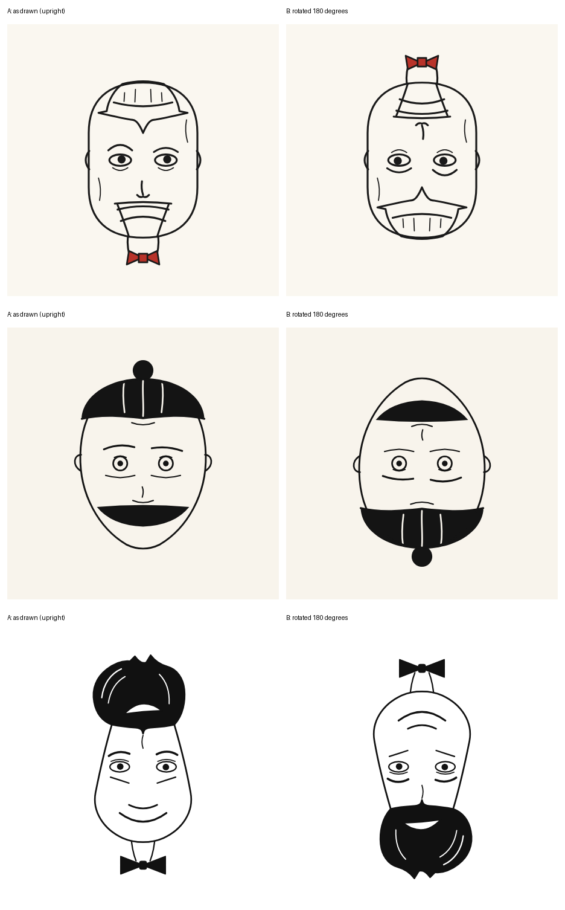

# Round 0 (pilot): prompt v1, not human-evaluated

The first end-to-end test of the setup. The three SVGs were checked for validity and were reviewed in a prompt critique by a second agent; they were **not** judged by the human evaluator. The results were used only to improve the prompt (v2).

| Model | Prompt | Tokens in / out | Cost (USD) | Finish |
|---|---|---|---|---|
| `deepseek/deepseek-v4.1-flash` | v1 | 4279 / 57638 | 0.0379 | stop |
| `z-ai/glm-5.3-flash` | v1 | 4332 / 22287 | 0.0046 | stop |
| `minimax/minimax-m3.1-flash` | v1 | 4389 / 54317 | 0.0329 | stop |
| **Total** | | | **0.0754** | |

Settings: one-shot via OpenRouter, no tools, default reasoning effort (medium) unless a second run of the same model was needed. Reasoning traces were large (60 to 225 KB) and are not included in this repository; the raw answers are in `raw/`.

What the pilot showed (from a critique by a second agent that looked at the outputs): the models produced valid SVGs, but with weak expression contrast, oval heads with generic eyes, little visible joke, and a lot of token budget spent on coordinate arithmetic. The v2 changes target these points (see `../../docs/prompt-evolution.md`).

*Top to bottom: DeepSeek, GLM, MiniMax.*
