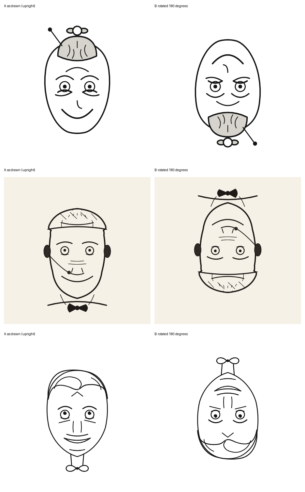

# Round 1: prompts v2 and v3, human-evaluated

Evaluator: the benchmark's author (Claudio Drews). Date: 2026-10-28.

| # | File | Model (OpenRouter) | Prompt | Tokens in / out | Cost (USD) | Reversible effect | Artistic quality | Humor | Current event |
|---|---|---|---|---|---|---|---|---|---|
| 1 | `svg/deepseek-v4.1-flash_prompt-v3.svg` | `deepseek/deepseek-v4.1-flash` | v3 | 4990 / 23700 | 0.0162 | OK | Low | Somewhat funny | Not used in an impactful way |
| 2 | `svg/glm-5.3-flash_prompt-v3.svg` | `z-ai/glm-5.3-flash` | v3 | 5055 / 8111 | 0.0034 | Somewhat bad | Low | — | Not used in an impactful way |
| 3 | `svg/minimax-m3.1-flash_prompt-v2.svg` | `minimax/minimax-m3.1-flash` | v2 | 4894 / 61524 | 0.0373 | OK | Low | Somewhat funny | Not used in an impactful way |

(The MiniMax run on prompt v3 was interrupted before it finished, so its prompt-v2 output was evaluated instead. DeepSeek and GLM also have prompt-v2 runs in `not-evaluated/`; they were superseded by v3 and not judged.)

## The evaluation

> "The first and the third are OK in effect. The second is somewhat bad in effect. None of the three has much artistic quality. The first and the third are somewhat funny. But none of them uses current events in an impactful way."

## How these were generated

One-shot via OpenRouter, no tools, default reasoning effort (medium), prompt as the only message. Raw answers and reasoning traces are in `raw/`; token and cost logs are in `logs/`. Cost of evaluated runs: US$0.0569; including the unevaluated v2 runs for DeepSeek (0.0193) and GLM (0.0039): US$0.0801.

## Conclusions that fed round 2

- The effect is achievable: two of three models produced a working two-face drawing.
- The general weakness is artistic quality.
- The current event has to become central and impactful (reversing the earlier decision to treat it only as a pretext).

*Top to bottom: DeepSeek (v3), GLM (v3), MiniMax (v2).*
