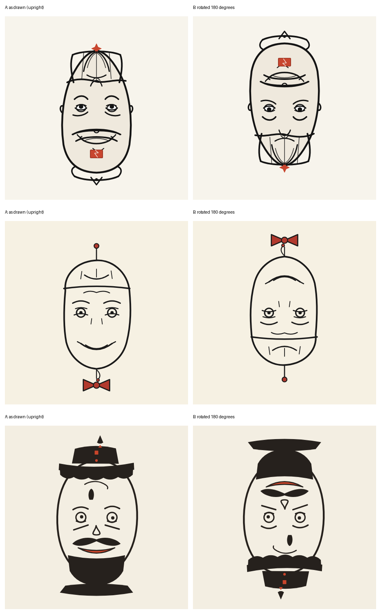

# Round 3: prompt v5, human-evaluated

Evaluator: the benchmark's author (Cláudio Drews). Date: 2026-10-29.

Prompt v5 was rebuilt from v3 with reversibility as the absolute priority, a staged workflow (geometry, rotation check, style), a light event requirement and three short art cues.

| # | File | Model | Settings | Tokens in / out | Cost (USD) | Event declared | Title declared |
|---|---|---|---|---|---|---|---|
| 1 | `svg/deepseek-v4.1-flash_prompt-v5.svg` | `deepseek/deepseek-v4.1-flash` | one-shot, **reasoning disabled**, max 20000 tokens | 4956 / 2407 | 0.0043 | AI model release hype cycle, mid-2020s | The Promise and the Prompt |
| 2 | `svg/glm-5.3-flash_prompt-v5.svg` | `z-ai/glm-5.3-flash` | one-shot, reasoning effort medium, max 64000 tokens | 5042 / 8533 | 0.0035 | AI assistant launch demo, 2024: triumphant unveil vs. the confident wrong answer | Launch Antenna / Dead Battery |
| 3 | `svg/minimax-m3.1-flash_prompt-v5.svg` | `minimax/minimax-m3.1-flash` | one-shot, **reasoning effort low**, max 40000 tokens | 5085 / 36639 | 0.0219 | ChatGPT launch and the AI boom, followed by "the plug gets pulled" (late 2022 onward) | The Plug Gets Pulled |

`<title>`/`<desc>`/`<metadata>` were stripped from the SVGs by the script (`STRIP_METADATA=1`). All three validate with `scripts/validate_svg.py` and open standalone in Chrome.

## The evaluation, in the evaluator's words

> "Nesta terceira rodada os três modelos se saíram melhor. Todos conseguiram fazer imagens identificáveis em ambas orientações e a qualidade artística melhorou."

English translation: *In this third round all three models did better. All of them managed to make identifiable images in both orientations, and the artistic quality improved.*

## Costs (from `logs/COSTS.md`)

- Run A (default effort): DeepSeek US$0.0581 (hit the 64000-token cap, no SVG) + GLM US$0.0035 (delivered) = US$0.0616.
- Run C (DeepSeek, effort low): US$0.0571, token cap hit, no SVG.
- Run D (DeepSeek, reasoning limited to 14000 tokens): US$0.0268, the limit was not enforced by the provider; cap hit at 30000 tokens, no SVG.
- Run with `prompt-v5b` (DeepSeek, effort low): US$0.0225, cap hit at 24000 tokens, no SVG.
- Run with reasoning disabled (DeepSeek, prompt v5): US$0.0043, **delivered**.
- MiniMax: first attempt timed out after 900 s (cost not reported by the provider, up to roughly US$0.04); second attempt (low effort, max 40000 tokens) US$0.0219, **delivered**.
- Delivered runs: US$0.0297. Everything reported, including failures: US$0.194, plus the one timed-out request.

## Caveats

- **DeepSeek's output was produced with reasoning disabled.** With reasoning on (three configurations, plus the v5b prompt variant) it kept re-verifying its own geometry until the token limit and delivered nothing. Its result is therefore not directly comparable with GLM's and MiniMax's.
- MiniMax ran at low effort.
- The models' declared events are generic in two of three cases (DeepSeek's "AI model release hype cycle" is not a specific event). The event is still weak; making it central without breaking the illusion remains open.

## Next steps suggested by this round

- v5 is the new base: reversibility preserved by the staged workflow.
- Add event and art in small doses, one at a time, protecting the 180° reading after each addition.
- Find a way to make DeepSeek-like models stop verifying without turning reasoning off completely.

*Top to bottom: DeepSeek, GLM, MiniMax.*
