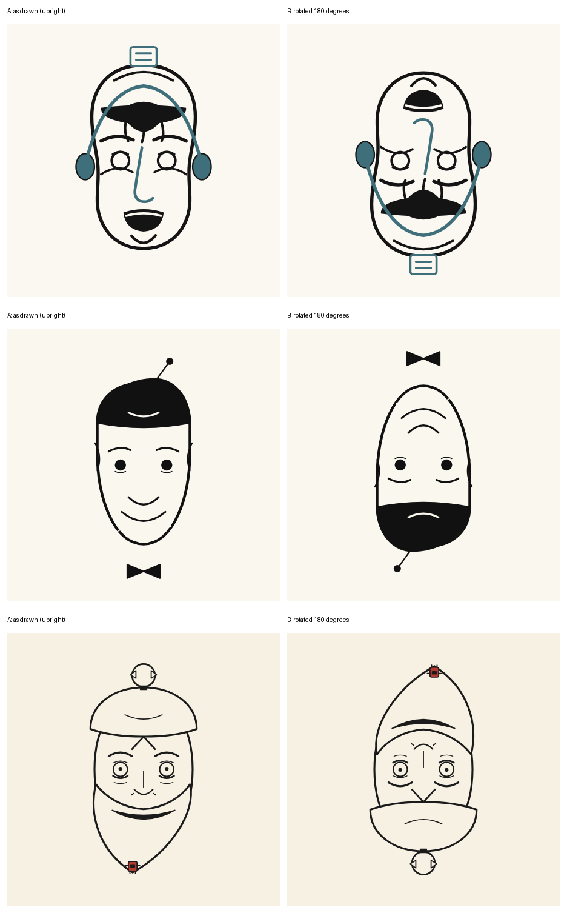

# Round 4: prompt v6, tool-enabled, human-evaluated

Evaluator: the benchmark's author (Claudio Drews). Date: 2026-10-29.

Prompt v6 is prompt v5 with the same task and the same priority order (reversibility first; contrast; light touches), but the models could **run code and look at their own drawing** through a tool loop: a sandboxed Python tool and a render tool that shows the SVG upright (A) and rotated by 180° (B), with text diagnostics. At most 5 renders. See [`SETUP.md`](SETUP.md) for the harness, the limits and the differences from v5 (several things changed besides the tools).

| # | File | Model | Settings | Turns / tool calls / renders | Tokens in / out (all turns) | Cost (USD) | Event declared | Title declared |
|---|---|---|---|---|---|---|---|---|
| 1 | `svg/deepseek-v4.1-flash_prompt-v6.svg` | `deepseek/deepseek-v4.1-flash` | tools, **reasoning disabled**, max 20000 tokens per turn | 11 / 11 / 5 | 137,666 / 10,633 | 0.0232 | the generative-AI hype cycle: launch-day promise to post-launch burnout (approx. 2023–2025) | Headset Hype, Server Sag |
| 2 | `svg/glm-5.3-flash_prompt-v6.svg` | `z-ai/glm-5.3-flash` | tools, reasoning effort medium, max 32000 per turn | 10 / 9 / 4 | 153,508 / 11,504 | 0.0116 | the big AI chatbot/agent product launch wave of 2024–2025: launch-day euphoria vs. the tired aftermath | Launch Day, Six Months Later |
| 3 | `svg/minimax-m3.1-flash_prompt-v6.svg` | `minimax/minimax-m3.1-flash` | tools, **reasoning effort low**, max **64000** per turn (**re-run**, see below) | 12 / 11 / 5 | 836,616 / 80,012 | 0.0781 | humanoid AI robots / AI agents going to work (2024–25) | The Beard Is a Hat Now |
| extra | `not-evaluated/minimax-m3.1-flash_run1-no-tools-used_prompt-v6.svg` | `minimax/minimax-m3.1-flash` | first run: tools offered, effort low, max 32000 per turn; **never called a tool** | 2 / 0 / 0 | 43,494 / 33,415 | 0.0263 | the 2023–2025 generative-AI chatbot boom and the "unplugged" hangover | Plug Pulled |

The delivered SVGs are pixel-identical to the last render each model looked at. No `<title>`/`<desc>`/`<metadata>`. All validate with `scripts/validate_svg.py` and open standalone in Chrome (upright and rotated by 180°). The first MiniMax run is kept as an extra and was not part of the evaluated set.

## The evaluation

> "The three models managed to create the reversible images. The images are well made, interesting, but they do not convey a comic message."

(Translated from Portuguese by the repository maintainers.)

Summary (ours, not the evaluator's): the reversible effect worked for all three models and the images were judged well made and interesting. The weak point is now **humor**: none of the three conveys a comic message. The evaluator did not compare the art with round 3 explicitly.

## Notes on the outputs (the maintainers' description of the files, not part of the verdict)

- **DeepSeek:** both readings are faces, but B is cluttered: a black moustache mass sits where a mouth would be and a headset arc crosses the face in both readings.
- **GLM:** the simplest and cleanest: a grinning man with a dark cap, an antenna and a bow tie; rotated, a frowning bearded man with the bow tie as a pompom and a dangling antenna.
- **MiniMax (re-run):** the most Whistler-like: a bearded man in a domed hat with a refresh-arrows icon; rotated, a frowning man in a tall pointed hat. The event is only vaguely hinted at.
- None of the files is rotationally symmetric; none contains text.

## Costs (from [`logs/COSTS.md`](logs/COSTS.md))

- DeepSeek US$0.0232; GLM US$0.0116; MiniMax first run US$0.0263 (no tool use); MiniMax re-run US$0.0781.
- Delivered runs used in the evaluated set: US$0.113. Everything, including the first MiniMax run: US$0.139.

## Caveats

- **MiniMax was re-run once.** In the first run it spent all 32000 tokens of its first turn on reasoning (finish reason `length`) and never called a tool; the harness then forced a final answer. Because the condition under test is "with tools", it was re-run once with 64000 tokens per turn (the only change), and the re-run is the MiniMax result above. That is a selection between two runs, and should be described as such.
- **Not a clean comparison with round 3.** Besides the tools, prompt v6 removed the unverified Whistler descriptions and the placeholder note, made the dictionary frame wording precise, changed the title to "OHO!", and changed Stage 2 (written rotation, then render and blind reading). The effect of the tools cannot be separated from these changes. One run per model; one evaluator who is also the author; DeepSeek ran with reasoning disabled; providers were not pinned.
- The events declared are model wording and were not fact-checked.

## What this round suggests

- With tools and a render of their own drawing, all three models keep the 180° reading and deliver well-made drawings, so the bottleneck has moved from geometry to **humor**.
- The next experiments should target the joke (the A/B contrast and the event) without endangering the reversible reading; see [`../../docs/future-work.md`](../../docs/future-work.md). A control (prompt v5 with tools, or prompt v6 without tools) would separate the tool effect from the prompt changes.

*Top to bottom: DeepSeek, GLM, MiniMax (re-run).*
